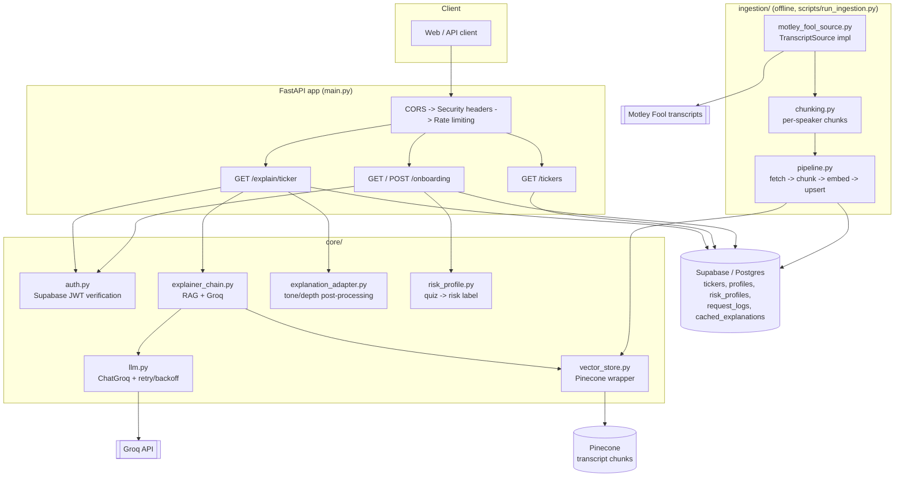

# Atlas Capital

**Stocks, plainly explained.**

A fintech MVP that turns dense quarterly earnings call transcripts into
plain-language explanations for regular consumers - no finance background
required. Built with family and retirement planning in mind, not day
trading.

Covers the top 15 US individual-company tickers by average daily trading
volume (ETFs/index funds/trusts excluded): NVDA, INTC, NOK, SOFI, ONDS,
AAPL, AMZN, PATH, PLTR, AAL, F, T, PLUG, NU, SNAP.

## How it works

1. **Ingestion** scrapes the latest earnings call transcript for each
   ticker, splits it into per-speaker chunks (prepared remarks vs. Q&A),
   embeds them locally, and upserts them to Pinecone.
2. **`GET /explain/{ticker}`** retrieves the most relevant chunks, asks
   Groq (`llama-3.3-70b-versatile`) to produce a grounded, plain-language
   explanation with citations, and caches it in Supabase so repeat
   requests are free.
3. **`POST /onboarding`** collects a 5-question quiz and derives a risk
   profile (conservative / moderate / aggressive). `GET /explain` then
   adapts tone and depth to that profile - more glossary definitions for
   beginners, a tailored closing note based on risk comfort - as a cheap,
   deterministic post-processing pass on the cached explanation, not a
   second LLM call.
4. **`GET /onboarding`**
   retrieves the authenticated user's saved profile so onboarding state
   persists across page visits.

## Architecture



## Setup

Requires Python 3.11+, a Supabase project, a Pinecone account, and a Groq
API key.

```bash
python -m venv venv
./venv/Scripts/pip install -r requirements.txt   # venv/bin/pip on macOS/Linux

cp .env.example .env
# fill in GROQ_API_KEY, PINECONE_API_KEY, SUPABASE_URL, SUPABASE_ANON_KEY,
# SUPABASE_SERVICE_ROLE_KEY, DATABASE_URL

./venv/Scripts/python.exe scripts/apply_migrations.py    # applies /migrations, idempotent
./venv/Scripts/python.exe scripts/seed_tickers.py         # seeds tickers table from config/tickers.py
./venv/Scripts/python.exe scripts/run_ingestion.py         # ingests all 15 tickers (takes a while)

./venv/Scripts/python.exe -m uvicorn main:app --reload
```

Then visit `http://localhost:8000/docs` for interactive API docs.

### Frontend

A minimal Next.js (App Router, TypeScript, Tailwind) UI lives in `/frontend` -
ticker grid, an explanation page (sections/citations/glossary), and a
risk-profile quiz. Auth is Supabase email/password via `@supabase/supabase-js`
directly in the browser (no custom backend auth).

```bash
cd frontend
npm install
cp .env.local.example .env.local   # fill in NEXT_PUBLIC_SUPABASE_URL / NEXT_PUBLIC_SUPABASE_ANON_KEY
                                     # (same Supabase project as the backend's .env)
npm run dev
```

Visit `http://localhost:3000`. Make sure `CORS_ALLOWED_ORIGINS` in the
backend's `.env` includes the frontend's origin.

### Useful commands

```bash
./venv/Scripts/python.exe -m pytest tests/ -q                    # run tests
./venv/Scripts/python.exe -m uvicorn main:app --reload            # run the API locally
./venv/Scripts/python.exe scripts/apply_migrations.py             # apply any new migrations (idempotent)
./venv/Scripts/python.exe scripts/seed_tickers.py                 # seed/refresh the tickers table
./venv/Scripts/python.exe scripts/run_ingestion.py [TICKER ...]   # ingest transcripts (all 15 if no args)
./venv/Scripts/python.exe scripts/verify_transcripts.py           # re-check scraper health across all 15
```

## API

| Endpoint                | Auth     | Notes                                                                                                                                                                    |
| ----------------------- | -------- | ------------------------------------------------------------------------------------------------------------------------------------------------------------------------ |
| `GET /tickers`          | none     | Supported tickers + latest ingested quarter                                                                                                                             |
| `GET /explain/{ticker}` | optional | 404 if unsupported/not yet ingested. Cached explanations are free to read anonymously; generating a new one (cache miss) requires sign-in, since it burns Groq quota. Adapts to the caller's risk profile if signed in and onboarded. |
| `GET /onboarding`       | required | Returns the authenticated user's saved risk profile. 404 if onboarding has not been completed. |
| `POST /onboarding`      | required | 5-question quiz -> upserts a risk profile                                                                                                                               |
| `GET /health`           | none     | Liveness check                                                                                                                                                          |

Auth is bearer-token: pass a Supabase Auth JWT as `Authorization: Bearer <token>`.

## Security notes

- **Row Level Security**: every Supabase table holding data has RLS
  enabled (see `/migrations`, especially `002`-`006`). `risk_profiles` is
  fully owner-scoped (`auth.uid() = user_id`) for select/insert/update/delete.
  `request_logs` allows anonymous inserts (for audit logging) but no reads
  at all, even for the row's own owner. `cached_explanations` allows public
  reads but restricts writes to authenticated callers - a deliberate
  trade-off documented in `CLAUDE.md`: anyone can read an already-generated
  explanation for free, but generating a new one requires an account.
  `tickers` is public-read, admin-write only.
- **No custom auth**: the app uses Supabase Auth exclusively (`core/auth.py`
  hands bearer tokens to Supabase's own `auth.get_user()` for verification -
  JWTs are never decoded/verified locally). `passlib` is listed as a
  dependency per the original spec but isn't used, since there's no
  password handling in this codebase to hash.
- **Service role key**: `SUPABASE_SERVICE_ROLE_KEY` (RLS bypass) is only
  ever read by offline/admin scripts (`scripts/`, via
  `core.supabase_client.get_admin_client()`). No code path reachable from a
  client request uses it - every request-handler Supabase call goes through
  `get_request_client()`, which uses the anon key and applies RLS.
- **Rate limiting**: `slowapi`-backed, keyed per-user (hashed bearer token)
  when authenticated, per-IP otherwise (see `core/rate_limit.py`). App-wide
  default of 100 requests/minute; `GET /explain/{ticker}` is stricter at
  10/minute since it can trigger a Groq call. Rate-limited responses return
  `429` with a `Retry-After` header.
- **Security headers**: `core/security_headers.py` adds
  `Strict-Transport-Security`, `X-Content-Type-Options`, `X-Frame-Options`,
  `Referrer-Policy`, `Permissions-Policy`, and `Cross-Origin-Opener-Policy`
  to every response.
- **CORS**: explicit allowlist via `CORS_ALLOWED_ORIGINS` (never `*`),
  wired in `main.py`.
- **Input validation**: all request bodies are Pydantic models with
  constraints matching the underlying DB check constraints (e.g.
  `POST /onboarding`); the `{ticker}` path param is checked against a
  static allowlist. No raw string interpolation is used to build any
  database query or scraper URL - Supabase access goes through the
  parameterized `postgrest`/`supabase-py` client, and ingestion URLs are
  built from a fixed template with numeric year/month, never user input.
- **Logging**: no secrets, tokens, or full request bodies are logged
  anywhere - log statements reference tickers/quarters/status codes/latency
  only.

## Design notes

- The transcript source is abstracted behind `ingestion/base.py`'s
  `TranscriptSource` interface, so the Motley Fool implementation can be
  swapped out later without touching the chunking/embedding/explain code.
- Explanation caching is per `(ticker, quarter)`, shared across all users -
  risk-profile adaptation happens per-request at serve time
  (`core/explanation_adapter.py`), so the expensive RAG + Groq generation
  step never repeats per user.
- Embeddings are generated locally (`fastembed`, ONNX, `BAAI/bge-small-en-v1.5`)
  rather than via a paid API, since Groq doesn't serve an embeddings model
  and the brief didn't provision a separate embeddings key.

See `CLAUDE.md` for the full build history, gotchas, and design
decisions behind the choices above.
