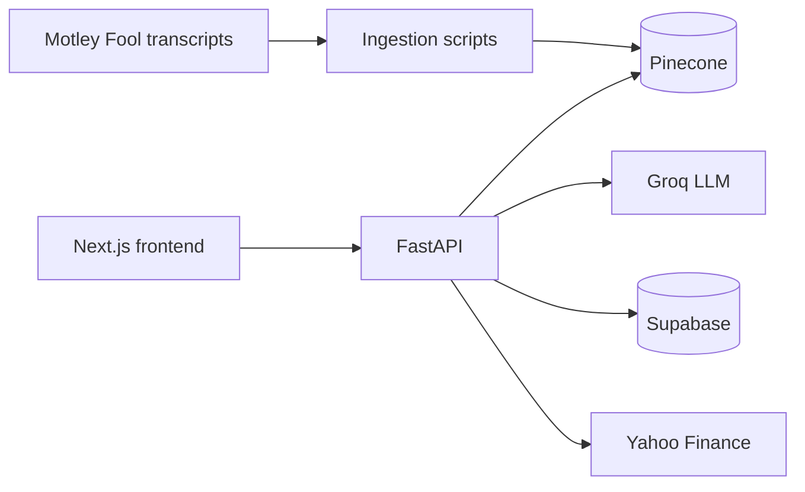

# Atlas Capital

**Stocks, plainly explained.**

Atlas turns dense quarterly earnings calls into plain-language explanations
for people with no finance background. It covers 15 heavily traded US stocks,
plus 15 US and 15 Canadian ETFs with price charts, key stats, and holdings.

## How it works



1. Ingestion scrapes each stock's latest earnings call, splits it into chunks,
   and stores them in Pinecone.
2. `GET /explain/{ticker}` retrieves the relevant chunks, asks Groq for a
   plain-language explanation with citations, and caches the result in
   Supabase.
3. A short preferences form sets a risk profile, which adjusts the glossary
   and closing note on each explanation.

## Setup

Requires Python 3.11+, Node.js, a Supabase project, a Pinecone account, and a
Groq API key.

### Backend

```bash
python -m venv venv
./venv/Scripts/pip install -r requirements.txt   # venv/bin/pip on macOS/Linux
cp .env.example .env                             # then fill in the values

./venv/Scripts/python.exe scripts/apply_migrations.py   # create the database tables
./venv/Scripts/python.exe scripts/seed_tickers.py       # load the ticker list
./venv/Scripts/python.exe scripts/run_ingestion.py      # ingest transcripts (takes a while)

./venv/Scripts/python.exe -m uvicorn main:app --reload
```

The API runs at `http://localhost:8000`. See `http://localhost:8000/docs` for
the full list of endpoints.

### Frontend

Create `frontend/.env.local`:

```bash
NEXT_PUBLIC_SUPABASE_URL=
NEXT_PUBLIC_SUPABASE_ANON_KEY=
NEXT_PUBLIC_API_BASE_URL=http://localhost:8000
```

Then run:

```bash
cd frontend
npm install
npm run dev
```

The site runs at `http://localhost:3000`. Make sure `CORS_ALLOWED_ORIGINS` in
the backend's `.env` includes this address.

### Tests

```bash
./venv/Scripts/python.exe -m pytest tests/ -q
```

## Security

- **Database access:** Row Level Security is on for every table, and users can
  only reach their own private data.
- **Sign-in:** Supabase Auth handles accounts and passwords.
- **Service role key:** Only offline admin scripts use it, never request
  handlers.
- **Rate limits:** 100 requests per minute by default and 10 per minute on
  `/explain`. Requests over the limit get a `429` with `Retry-After`.
- **Requests and responses:** CORS uses an explicit allowlist, inputs are
  validated with Pydantic, and security headers are set on every response.
