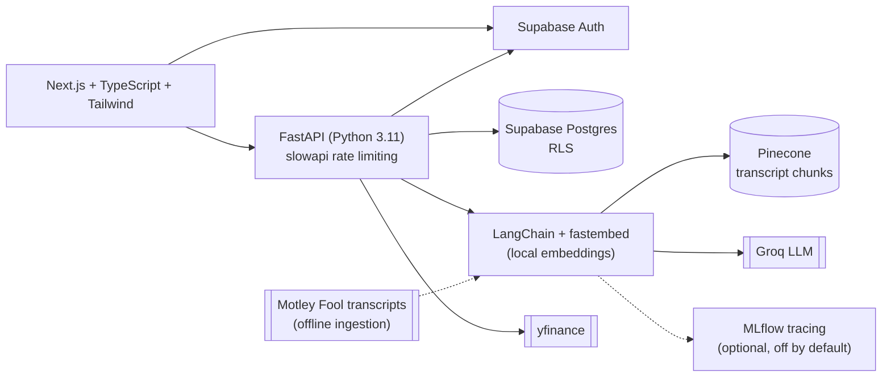

# Atlas Capital

**Stocks, plainly explained.**

Live at https://www.atlasaiexplainer.com/

A website that turns dense quarterly earnings calls into
plain-language explanations for regular consumers - no finance background
required. Built with family and retirement planning in mind, not day
trading.

Covers the 15 most actively traded US companies (ETFs and index funds
excluded): NVDA, INTC, NOK, SOFI, ONDS,
AAPL, AMZN, PATH, PLTR, AAL, F, T, PLUG, NU, SNAP.

Also covers the top 15 most actively traded US ETFs and top 15 Canadian
ETFs (leveraged/inverse funds excluded), with price charts, key stats,
top holdings, and sector breakdowns for each.

## How it works

1. **Collecting transcripts.** We pull the latest earnings call for each
   company, split it into small pieces by speaker (prepared remarks vs.
   analyst questions), and store them so they can be searched.
2. **Plain-language explanations.** For each company we find the most
   relevant parts of the call and ask an AI model to explain them simply,
   with quotes backing up each claim. Explanations are saved, so repeat
   visits are instant.
3. **Personal quiz.** A short 5-question quiz sets a risk profile
   (conservative, moderate or aggressive). Explanations then adjust to it,
   for example with more definitions for beginners and a closing note that
   fits how much risk you are comfortable with. This is a light touch-up,
   not a second AI request.
4. **Charts and key numbers.** Price history and measures like P/E, beta
   and Sharpe ratio for any supported stock or ETF, fetched live rather
   than saved.
5. **ETFs.** Supported US and Canadian ETFs, with top holdings and a sector
   breakdown.
6. **Ask a question.** A chat box on each stock page lets a signed-in user
   ask about the latest call. Answers come only from that call and include
   quotes that are checked against the transcript.
7. **Sentiment.** A simple tone score for the prepared remarks compared with
   the analyst Q&A.
8. **Similar stocks and ETFs.** Suggestions based on clear rules, like the
   same sector or fund type.
9. **Strategy overview.** A general, educational description of what a
   user's risk profile usually means in practice. It is not personal advice
   and never names specific stocks.

## Architecture

## Security

- **Each user only sees their own data.** Every database table that holds
  user data has row-level security turned on. A person's quiz answers can
  only be read or changed by that person. Request logs can be written but
  never read back by anyone using the app.
- **Shared explanations are public to read.** Anyone can read an
  explanation that has already been generated, for free. Creating a new one
  requires an account, so strangers can't use up the AI quota.
- **Sign-in is handled by Supabase.** The app never stores or checks
  passwords itself.
- **The all-powerful admin key stays offline.** It is only used for
  behind-the-scenes maintenance, never by anything that responds to a
  visitor.
- **Rate limits.** Each user (or visitor, if not signed in) can only make so
  many requests per minute. Features that call the AI are limited more
  tightly. Anyone over the limit is told how long to wait.
- **Safe web defaults.** Standard security settings are added to every
  response, and only the approved website addresses are allowed to talk to
  the backend.
- **Input checking.** Everything a user sends is validated before use, and
  tickers must be on the supported list.
- **No sensitive logging.** Logs never contain passwords, sign-in tokens or
  what users typed, only things like the ticker, status and response time.

## Design notes

- **Swappable transcript source.** The place transcripts come from (Motley
  Fool today) can be replaced without changing the rest of the app.
- **One explanation per company and quarter.** It is generated once and
  shared by everyone. Personalizing it for a user's risk profile happens
  when it is shown, so the costly AI step is never repeated per user.
- **Free local embeddings.** Transcript text is turned into searchable form
  on our own machine rather than through a paid service.
- **Live market data.** Prices, charts, key stats and ETF holdings are
  fetched fresh from Yahoo Finance each time. It's plain market data, not
  AI-written, so there's nothing to cache. Some measures, such as Sharpe
  ratio, are calculated from the past year of daily prices.
- **Citations are checked.** Each quote the AI cites must really appear in
  the transcript passage it points to. Any that don't are dropped, and the
  answer is retried once if none survive.
- **Old explanations refresh.** If the instructions given to the AI change,
  previously saved explanations are regenerated instead of reused.
- **Sentiment is a rough guide.** The tone score comes from a general word
  list, not a finance-specific model, and it reads business language as
  slightly positive. Compare companies or sections to each other rather
  than treating a score as absolute.
- **Optional tracing.** MLflow tracing of the AI calls can be switched on
  for debugging. It is off by default, and it never records user identities
  or sign-in details.

## Evaluation

We tested two ways of answering questions about a call: finding the most
relevant passages (what the live site does) versus giving the AI the whole
transcript. The test had 24 questions with known answers and 6 questions
the transcripts can't answer, across 5 companies. Answers were produced by
Claude, and Groq's AI model graded them. This was a single run.

| Approach | Correct | Found the right evidence | Valid citations | Declined unanswerable questions | Text read per question |
| --- | --- | --- | --- | --- | --- |
| Relevant passages (live) | 63% | 14 of 24 | 100% | 6 of 6 | ~1.9K tokens |
| Whole transcript | 94% | 23 of 24 | 100% | 6 of 6 | ~11.8K tokens |

Giving the AI the whole transcript was clearly more accurate, but it reads
about six times as much text. The live site keeps the cheaper approach
because a full transcript doesn't fit within Groq's free-tier limits.
