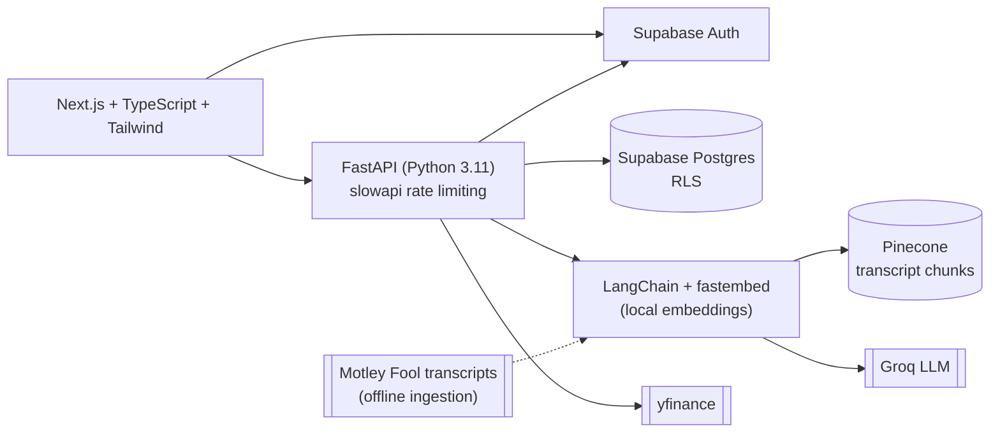

# Atlas Capital

**Stocks, plainly explained.**

Live at https://www.atlasaiexplainer.com/

A fintech MVP that turns dense quarterly earnings call transcripts into
plain-language explanations for regular consumers - no finance background
required. Built with family and retirement planning in mind, not day
trading.

Covers the top 15 US individual-company tickers by average daily trading
volume (ETFs/index funds/trusts excluded): NVDA, INTC, NOK, SOFI, ONDS,
AAPL, AMZN, PATH, PLTR, AAL, F, T, PLUG, NU, SNAP.

Also covers the top 15 most actively traded US ETFs and top 15 Canadian
ETFs (leveraged/inverse funds excluded), with price charts, key stats,
top holdings, and sector breakdowns for each.

## How it works

1. **Ingestion** scrapes the latest earnings call transcript for each
   ticker, splits it into per-speaker chunks (prepared remarks vs. Q&A),
   embeds them locally, and upserts them to Pinecone.
2. **Explanations**: relevant chunks are retrieved and Groq
   (`openai/gpt-oss-120b`) produces a grounded, plain-language explanation
   with citations. Results are cached in Supabase so repeat requests are
   free.
3. **Onboarding** is a 5-question preferences form that derives a risk
   profile (conservative / moderate / aggressive), saved per user. Explanations
   then adapt tone and depth to that profile - more glossary definitions for
   beginners, a tailored closing note based on risk comfort - as a cheap,
   deterministic post-processing pass on the cached explanation, not a
   second LLM call.
4. **Charts and stats** show price history and valuation/risk metrics (P/E,
   Sharpe ratio, beta, etc.) for any supported stock or ETF, pulled live
   from the market data provider rather than cached. These are read-only
   market data lookups, not AI-generated content.
5. **ETFs**: supported US and Canadian ETFs, with top holdings and sector
   breakdowns.
6. **Chat** is a panel on each stock page: a signed-in reader asks a
   question about the latest call and gets an answer grounded in that call's
   transcript chunks, with citations checked the same way as explanations
   (quotes must appear verbatim in the cited chunk). Not cached, so it has
   the tightest rate limit.
7. **Sentiment** scores the ingested call's chunks with VADER and shows the
   average tone for prepared remarks vs. Q&A.
8. **Similar items** suggests related stocks or ETFs from simple,
   explainable rules (same sector/industry, same fund category).
9. **Strategy overview** gives a signed-in, onboarded user a general,
   educational overview of what their risk profile usually means in
   practice. Not personalized advice and no specific tickers; cached per
   (risk profile, experience level), so there are at most 12 versions.

## Architecture

## Security notes

- **Row Level Security**: every Supabase table holding data has RLS
  enabled (see `/migrations`, especially `002`-`006`). `risk_profiles` is
  fully owner-scoped (`auth.uid() = user_id`) for select/insert/update/delete.
  `request_logs` allows anonymous inserts (for audit logging) but no reads
  at all, even for the row's own owner. `cached_explanations` allows public
  reads but restricts writes to authenticated callers - a deliberate
  trade-off: anyone can read an already-generated
  explanation for free, but generating a new one requires an account.
  `tickers` is public-read, admin-write only. `cached_strategy_overviews`
  follows the same pattern as `cached_explanations` (public read,
  authenticated write). `explanation_requests` is owner-scoped for
  select/insert/delete.
- **No custom auth**: the app uses Supabase Auth exclusively (`core/auth.py`
  hands bearer tokens to Supabase's own `auth.get_user()` for verification -
  JWTs are never decoded/verified locally). `passlib` is listed as a
  dependency per the original spec but isn't used, since there's no
  password handling in this codebase to hash.
- **Service role key**: `SUPABASE_SERVICE_ROLE_KEY` (RLS bypass) is only
  ever read by offline/admin scripts (`scripts/`, via
  `core.supabase_client.get_admin_client()`). No code path reachable from a
  client request uses it - every request-handler Supabase call goes through
  `get_request_client()`, which uses the anon key and applies RLS.
- **Rate limiting**: `slowapi`-backed, keyed per-user (hashed bearer token)
  when authenticated, per-IP otherwise (see `core/rate_limit.py`). App-wide
  default of 100 requests/minute; explanations and strategy
  overviews are stricter at 10/minute since they can trigger a Groq call,
  and chat is 5/minute since every question is an uncached Groq call. Rate-limited responses return
  `429` with a `Retry-After` header.
- **Security headers**: `core/security_headers.py` adds
  `Strict-Transport-Security`, `X-Content-Type-Options`, `X-Frame-Options`,
  `Referrer-Policy`, `Permissions-Policy`, and `Cross-Origin-Opener-Policy`
  to every response.
- **CORS**: explicit allowlist via `CORS_ALLOWED_ORIGINS` (never `*`),
  wired in `main.py`.
- **Input validation**: all request bodies are Pydantic models with
  constraints matching the underlying DB check constraints (e.g.
  the onboarding form); ticker path params are checked against a
  static allowlist. No raw string interpolation is used to build any
  database query or scraper URL - Supabase access goes through the
  parameterized `postgrest`/`supabase-py` client, and ingestion URLs are
  built from a fixed template with numeric year/month, never user input.
- **Logging**: no secrets, tokens, or full request bodies are logged
  anywhere - log statements reference tickers/quarters/status codes/latency
  only.

## Design notes

- The transcript source is abstracted behind `ingestion/base.py`'s
  `TranscriptSource` interface, so the Motley Fool implementation can be
  swapped out later without touching the chunking/embedding/explain code.
- Explanation caching is per `(ticker, quarter)`, shared across all users -
  risk-profile adaptation happens per-request at serve time
  (`core/explanation_adapter.py`), so the expensive RAG + Groq generation
  step never repeats per user.
- Embeddings are generated locally (`fastembed`, ONNX, `BAAI/bge-small-en-v1.5`)
  rather than via a paid API, since Groq doesn't serve an embeddings model
  and the brief didn't provision a separate embeddings key.
- Chart, stats, and ETF-holdings data (`core/market_data.py`,
  `core/ticker_stats.py`, `core/etf_holdings.py`) comes live from
  `yfinance` on every request rather than being cached or ingested - it's
  read-only market data, not AI-generated content, so there's no
  correctness reason to cache it and it costs no LLM/embedding quota to
  serve. Sharpe ratio, Sortino ratio, and alpha aren't provided by
  yfinance directly and are computed from trailing 1-year daily returns
  (methodology documented in `core/ticker_stats.py`); P/E, P/B, PEG,
  dividend yield, and beta are read straight from Yahoo's data.
- Citations are checked, not trusted: each one the model drafts must quote
  text that actually appears in the chunk it cites. Citations that fail are
  dropped, and if none pass, generation retries once. `/explain` and
  `/ask` share this check (`core/explainer_chain.py`).
- Cached explanations carry a prompt version, so changing the prompt
  regenerates old entries instead of serving stale ones.
- Sentiment uses VADER, a general-purpose lexicon, not a finance-tuned
  model. It reads corporate language as mildly positive, so compare scores
  between tickers or sections, not against an absolute scale.
- MLflow tracing (`core/tracing.py`) is off by default. With
  `MLFLOW_TRACING_ENABLED=true` it autologs the LangChain/Groq chains to a
  local `mlflow.db`. Traces hold prompts and outputs but no user ids,
  tokens or request bodies, and a tracing failure never takes the app down.

## Evals

`evals/` compares RAG (top-k chunks, what production does) with CAG (the
whole transcript in the prompt) on the `/ask` chain. The eval set
(`evals/atlas_eval_set.json`) has 24 answerable questions and 6
out-of-scope ones across 5 companies. Every reference quote is checked to
appear verbatim in its cited chunk. Both arms run the production
`answer_question` unchanged; only the model call and, for CAG, the
retrieval step are swapped.

Gemini's free tier couldn't finish the run, so answers came from blind
Claude subagents (`evals/claude_generator.py`), and Groq `gpt-oss-120b`
judged them. Results (`evals/results/report.md`), single run:

| Arm | Correctness | Cites gold evidence | Citations verified | Out-of-scope abstention | Input tokens / q |
| --- | --- | --- | --- | --- | --- |
| RAG | 0.625 | 14/24 | 100% | 6/6 | ~1.9K |
| CAG | 0.938 | 23/24 | 100% | 6/6 | ~11.8K |

CAG is significantly more correct (+0.31, 95% CI [+0.13, +0.52]) at about
6x the input tokens. Production stays on RAG because a whole transcript
doesn't fit Groq's free-tier 8K tokens/minute cap.
